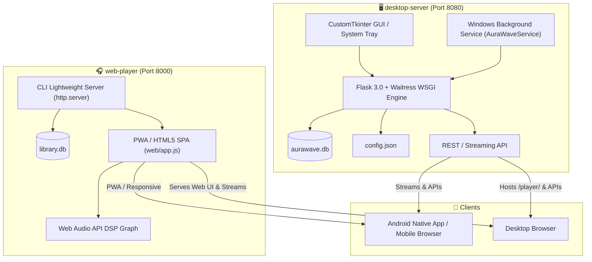

# 🌊 AuraWave: Architectural & Version Comparison

This document provides a comprehensive technical comparison of the **`desktop-server`** and **`web-player`** components, as well as the changes integrated from **`D:\Tech\Music Streamer`** into this GitHub repository (**`D:\Tech\AuraWave-web-player`**).

---

## 1. System Architecture: `desktop-server` vs. `web-player`

The AuraWave ecosystem provides two server architectures designed for different operational workflows:



### Side-by-Side Architectural Matrix

| Dimension | 🖥️ `desktop-server` | 🎧 `web-player` |
| :--- | :--- | :--- |
| **Primary Role** | Native Windows desktop hub, API gateway, and background service | Standalone browser-based player & lightweight streaming server |
| **Backend Framework** | **Flask 3.0.3** hosted on **Waitress 3.0.0** (multi-threaded WSGI) | Pure Python standard library (**`http.server.ThreadingHTTPServer`**) |
| **External Python Dependencies** | `customtkinter`, `Flask`, `waitress`, `mutagen`, `qrcode`, `pystray`, `Pillow` | Zero mandatory external dependencies (optional `mutagen`, `watchdog`) |
| **User Interface** | Native CustomTkinter dark/light GUI panel + Windows Notification Area (System Tray) | Full Single Page Application (SPA) in `web/` (`index.html`, `app.js`, `styles.css`) |
| **Web Player Delivery** | Routes `/player/` by mounting `web/` or sibling `../web-player/web` | Serves the SPA directly at the root `/` URL |
| **Windows Service Support** | **Yes** — native C# background Windows Service (`AuraWaveService.exe`, start on boot) | No — interactive CLI execution (`run.bat` / `run.sh` / `python web_player.py`) |
| **System Tray Support** | **Yes** — minimizes to Windows Notification Area with flyout tray menu | No — runs in terminal or console window |
| **Audio DSP Processing** | Server-side file serving, HTTP Range requests (`206`), Demucs stem extraction | Client-side 32-bit float **Web Audio API** processing pipeline in browser |
| **Local Database** | `aurawave.db` (scrobbles, plays, playlists, favorites, tag cache) | `library.db` (song library index, FTS search, scrobbles, tag cache) |
| **Configuration** | `config.json` (auto-saves `music_folder`, `port`, `threads`, `auto_start`) | CLI arguments (`--port`, `--folder`, `--cors`, `--threads`, `--scan-only`) |

---

## 2. Audio DSP & Client Capabilities (Web Player Engine)

The frontend Single Page Application (`web/app.js` and `web/index.html`) contains a modular Web Audio API signal graph:

```
Audio Source (<audio> tag / MediaElementSourceNode)
  ├── 10-Band Graphic Equalizer (BiquadFilterNodes: 32Hz - 16kHz)
  ├── Tone & Clarity:
  │     ├── Treble Crystalizer / Exciter
  │     ├── Vocal Clarity Booster
  │     ├── Sub-Bass (45Hz deep punch) & X-Bass (110Hz punch)
  │     └── De-Esser (sibilance tamer)
  ├── Spatial & 3D:
  │     ├── 8D Audio (dynamic 360° binaural orbit around listener)
  │     ├── 3D Virtual Surround (HRTF Panner3D)
  │     ├── Stereo Widen (Mid/Side processing + Haas delay)
  │     ├── Headphone Crossfeed (BS2B-style channel cross-bleed)
  │     └── Ping-Pong Stereo Echo (alternating L/R delay lines)
  ├── Atmosphere:
  │     ├── 7 Convolver Reverb Environments (Room, Hall, Stadium, Cathedral, Plate, Cave)
  │     ├── Analog / Tape Warmth (soft-clipping Waveshaper)
  │     └── Lo-Fi / Cassette Filter (vintage bandpass & head resonance)
  ├── Creative Quick Modes:
  │     ├── Slowed + Reverb (0.85× playback speed, pitch drop, lush reverb)
  │     ├── Nightcore (1.25× speed & pitch boost)
  │     └── Lo-Fi Chill (0.92× speed, cassette bandpass, tape warmth & room ambience)
  ├── Dynamics & Safety:
  │     ├── Night Mode (soft peak leveling via DynamicsCompressorNode)
  │     ├── Loudness Normalizer (Fletcher-Munson equal-loudness curve)
  │     └── Safety Peak Limiter (prevents digital clipping)
  └── Visualizer & Destination:
        ├── AnalyserNode (Oscilloscope, Spectrum Bars, Ring, Particles)
        └── AudioContext.destination
```

---

## 3. Comparison with `D:\Tech\Music Streamer`

The folder `D:\Tech\Music Streamer` contains significant architectural evolutions compared to the base repository. All enhancements have now been synchronized into `AuraWave-web-player`:

### A. Windows Service & Background Hosting (`desktop-server`)
- **Native C# Windows Service**: Added `AuraWaveService.cs` and pre-compiled `AuraWaveService.exe`. Allows AuraWave to start automatically when the computer boots, running in the background before any user logs in.
- **Service Management Suite**:
  - `service_manager.py`: Python CLI for querying status, installing, starting, stopping, and restarting the service.
  - `service_runner.py`: Headless runner spawned by the service to run Flask/Waitress.
  - `install_service.bat`, `start_service.bat`, `stop_service.bat`, `service_status.bat`, `uninstall_service.bat`: 1-click batch scripts.
  - **GUI Integration**: The desktop window now includes a real-time **Windows Service status strip** with 1-click service install/start/stop controls.

### B. System Tray Minimization (`desktop-server`)
- Added `pystray` and `Pillow` integration via `requirements-tray.txt`.
- When closing the desktop window, AuraWave can minimize to the Windows Notification Area / Hidden Icons flyout rather than terminating the server.

### C. Enhanced Analytics & Scrobble Dashboard (`desktop-server` & `web-player`)
- **Top Albums**: Added album scrobble aggregation to `/stats`.
- **14-Day Activity Chart**: Added daily listening distribution (`plays-per-day`).
- **24-Hour Listening Clock**: Added hourly histogram showing when listening occurs.
- **Per-Song Play Counts**: Added `/playcounts` endpoint returning a live `{path: count}` map.
- **Date Added Sorting**: Extracted `st_birthtime` / `st_ctime` via `_added_time()` and added `addedAt` timestamp to track metadata for chronological library sorting.

### D. Audio & PWA Upgrades (`web-player`)
- **Service Worker (`web/sw.js`)**: Added PWA Service Worker to host the "Now Playing" lockscreen notification and handle media button actions (Prev/Next/Play/Pause) across mobile and desktop browsers.
- **Quick Audio Presets**: 1-click buttons for **Slowed + Reverb**, **Nightcore**, and **Lo-Fi Chill**.
- **Ping-Pong Stereo Echo**: Configurable echo depth and delay time (ms).
- **Night Mode**: Dynamic peak compression to avoid sudden volume spikes during late-night listening.
- **Theme Customizer**: Replaced simple theme toggle with an aesthetic Theme Picker modal featuring multiple accent palettes (Emerald, Violet, Cyberpunk, Obsidian, etc.).

---

## 4. Git Synchronized Inventory

The following 23 files have been updated and committed to the Git repository:

| Path | Status | Key Changes |
| :--- | :--- | :--- |
| `.gitignore` | Modified | Added ignores for `aurawave.db*`, `service_state.json`, `service.log`, `stem_cache/` |
| `README.md` | Modified | Updated ecosystem features with Windows Service, System Tray, and Audio DSP |
| `desktop-server/app.py` | Modified | System tray minimize, config loading, date added, stats dashboard, service strip |
| `desktop-server/AuraWaveService.cs` | **New** | C# .NET Windows Service wrapper |
| `desktop-server/AuraWaveService.exe` | **New** | Compiled native Windows service host executable |
| `desktop-server/config.json` | **New** | Default configuration file (`music_folder`, `port`, `threads`) |
| `desktop-server/install_service.bat` | **New** | Windows Service installer batch script |
| `desktop-server/requirements-tray.txt` | **New** | Optional dependencies (`pystray`, `Pillow`) |
| `desktop-server/requirements.txt` | Modified | Updated dependency notes for tray and Demucs |
| `desktop-server/run.bat` | Modified | Best-effort installation of `requirements-tray.txt` |
| `desktop-server/service_manager.py` | **New** | Windows Service management CLI and control module |
| `desktop-server/service_runner.py` | **New** | Headless server runner invoked by the Windows Service |
| `desktop-server/service_status.bat` | **New** | Service diagnostic status script |
| `desktop-server/start_service.bat` | **New** | Service startup script |
| `desktop-server/stop_service.bat` | **New** | Service shutdown script |
| `desktop-server/uninstall_service.bat` | **New** | Service removal script |
| `desktop-server/README.md` | Modified | Comprehensive documentation on running as a Windows Service |
| `web-player/web_player.py` | Modified | Date added timestamps, `/playcounts` endpoint, 14-day stats & listening clock |
| `web-player/README.md` | Modified | Updated audio effect capabilities, stats, and play counters |
| `web-player/web/app.js` | Modified | Theme picker modal, quick audio modes, ping-pong echo, PWA service worker |
| `web-player/web/index.html` | Modified | Audio effect controls, theme modal scrim, quick preset chips |
| `web-player/web/styles.css` | Modified | Multi-theme accent variables, quick mode chips, modal styles |
| `web-player/web/sw.js` | **New** | Service worker for media notifications and background playback control |
