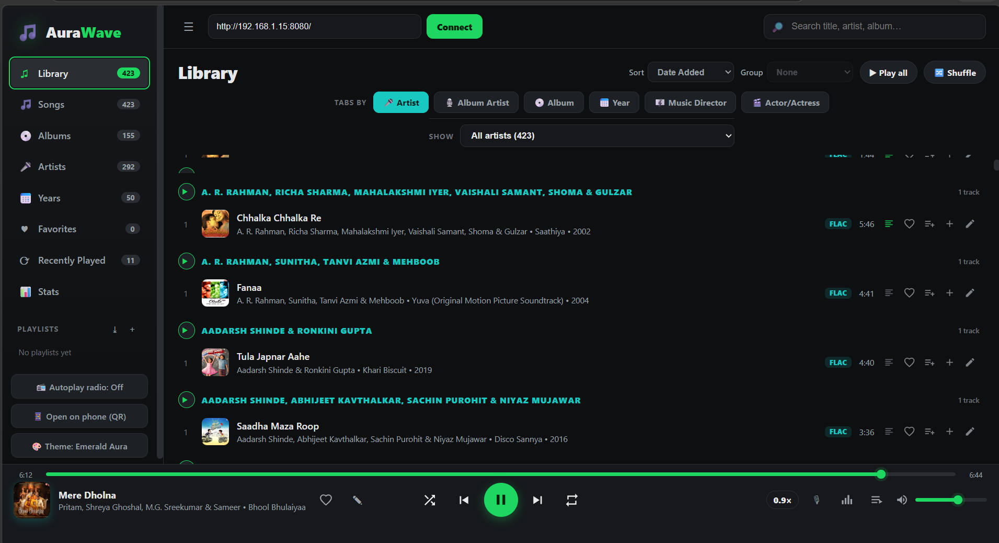
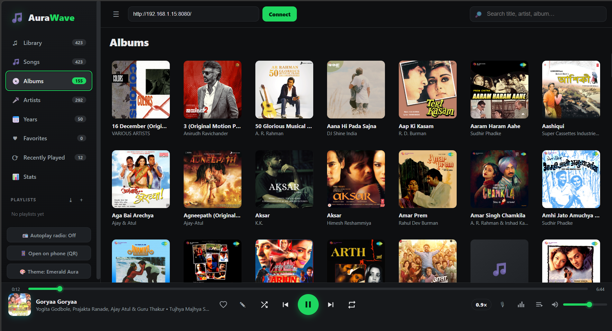
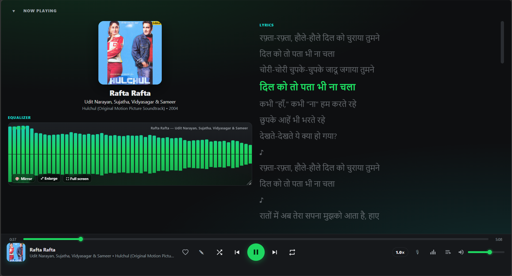
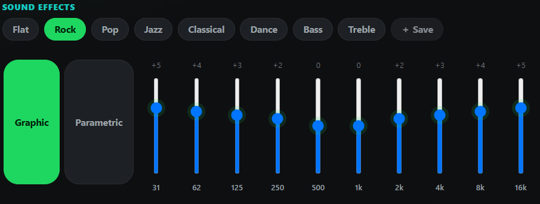
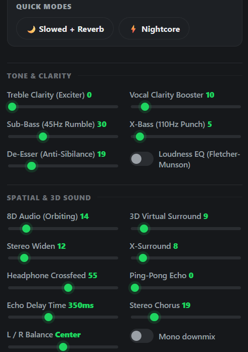
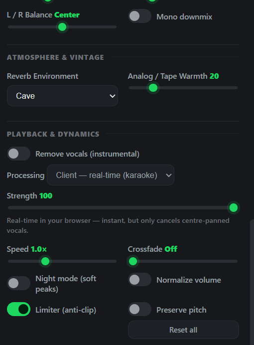

<div align="center">

# 🌊 AuraWave

### Your music. Your network. Your rules.

**A self-hosted, local Wi-Fi music-streaming ecosystem** — stream your own library
to any browser on your network. No cloud, no accounts, no subscriptions, no ads.

<br/>

[](https://www.python.org/)
[](#)
[](#)
[](#)
[](#)

<br/>

[**Features**](#-features) ·
[**Quick Start**](#-quick-start) ·
[**Screenshots**](#-screenshots) ·
[**Architecture**](#-architecture) ·
[**Configuration**](#️-configuration) ·
[**FAQ**](#-faq)

</div>

---

## ✨ What is AuraWave?

AuraWave turns a folder of music on your PC into a polished, full-featured music
player you can open in **any browser** — your phone, tablet, or another laptop — as
long as it's on the same Wi-Fi. Lossless **FLAC/WAV** files seek instantly thanks to
HTTP range streaming, and a rich **Web Audio** effects engine (equalizer, crossfeed,
reverb and more) runs entirely in the browser.

This bundle ships **three servers plus the Android app** — everything you need to
run AuraWave on a fresh machine:

<table>
<tr>
<td width="50%" valign="top">

### 🎧 `web-player/`
A **browser music player + streaming server**.
Dependency-light (Python standard library), with optional extras that unlock the
tag editor and instant folder-watching.

**Default port:** `8000`

</td>
<td width="50%" valign="top">

### 🖥️ `desktop-server/`
A **GUI streaming server** with Windows Service support (auto-start on boot), system tray minimization, and a live connected-devices panel. Also serves the web player UI at `/player/`.

**Default port:** `8080`

</td>
</tr>
<tr>
<td width="50%" valign="top">

### 📲 `update-server/`
An **OTA app-update server** (standard library only) that pushes the bundled
**Android APK** to phones over Wi-Fi via a QR code — no app store, no cable.
The latest `app-debug.apk` is included here.

**Default port:** `9696`

</td>
<td width="50%" valign="top">

### 📱 Android app
The native **AuraWave** Android client (`update-server/app-debug.apk`). Install it
by scanning the update server's "FIRST INSTALL" QR, then stream from either server.

**Package:** `com.aurawave.localmusicplayer`

</td>
</tr>
</table>

> The streaming servers run side by side (different ports), and the desktop server
> reuses the web player's UI from the sibling `web-player/web` folder. The update
> server is independent — run it whenever you need to install/update the phone app.

---

## 🚀 Features

### 🎵 Playback & Library
- 🔎 **Live search**, sort, and group — with a dedicated **Songs** (all-tracks) tab
- 💿 Browse by **Albums / Artists / Years**, plus **Favorites**, **Recently Played** & **Playlists**
- 🔀 Queue with non-repeating **shuffle** and **repeat** (Off / All / One)
- 🎚️ **Dual-deck engine** for true **crossfade / gapless** playback
- ⚡ **Instant seeking** on FLAC/WAV (HTTP Range `206`) with permissive CORS

### 🎛️ Audio Effects *(Web Audio, client-side)*
- 🎚️ **10-band graphic EQ** with genre presets **+** a **parametric EQ** (per-band frequency / Q / shelving)
- 🎧 **Headphone crossfeed** (BS2B-style) for natural headphone listening
- 🌈 Reverb (Room / Hall / Stadium), **stereo-widen**, **X-Bass**, **X-Surround**
- ⏩ Playback speed **0.5×–2.0×** (pitch-preserving) + loudness **normalization**
- 📊 A **6-style audio visualizer** (Bars / Mirror / Rainbow / Wave / Ring / Particles)

### 🗂️ Library Management & Data *(web-player server)*
- 👀 **Live folder watcher** — auto re-index on add/remove/change (`watchdog`, or a stdlib polling fallback)
- 🗃️ **SQLite index** with **FTS5 full-text search** + a metadata cache so re-scans skip unchanged files
- ✏️ **In-browser tag & cover-art editor** *(requires `mutagen`)*
- 📜 **M3U / PLS** playlist **import & export**
- 📈 **Local scrobbling** + a **Stats** view (top tracks/artists, listening time) — optional Last.fm push

### 🎤 Lyrics & Artwork
- 🎼 Synced `.lrc` / plain-text lyrics from local sidecars or the free **LRCLIB** API
- 🖼️ Album artwork fetched & cached server-side, plus embedded-cover support

### 📱 Connect in Seconds
- 📷 **QR code** — open `/qr`, scan with your phone, start playing
- 🎛️ **OS media controls / media keys** via the Media Session API
- 🌓 **Light / dark** theme, fully responsive

---

## 📸 Screenshots

<div align="center">

### 🎵 Library & Music Catalog
*Browse your entire collection with Date Added sorting, grouping by Artist/Album/Year/Director, instant search, and Emerald Aura theme.*



<br/><br/>

### 💿 High-Resolution Album Grid
*Grid view featuring dynamic album art caching, track counts, and responsive fluid layout.*



<br/><br/>

### 🎤 Now Playing, Synced Lyrics & Live Visualizer
*Karaoke-style synchronized lyrics highlighting with real-time multi-style audio spectrum visualizer.*



<br/><br/>

### 🎛️ Audiophile Sound Studio & Web Audio DSP Engine
*Complete client-side 32-bit float audio processing pipeline running in real-time in your browser.*

| 10-Band Graphic & Parametric EQ | Spatial, 3D & Tone Enhancements | Atmosphere & Dynamics |
|:---:|:---:|:---:|
|  |  |  |
| **10-Band EQ & Presets**<br/>Genre presets *(Rock, Pop, Jazz, Bass)* + custom frequency tuning | **Spatial & 3D Engine**<br/>8D Audio Orbit, 3D Surround, Headphone Crossfeed, Ping-Pong Echo, Sub-Bass & Clarity Booster | **Atmosphere & Dynamics**<br/>7 Convolver Reverbs, Analog Warmth, Lo-Fi Cassette Filter, Slowed+Reverb, Nightcore & Lo-Fi Chill |

</div>

---

## ⚡ Quick Start

> **Requirements:** Python **3.8+**. The core runs on the standard library alone.

<details open>
<summary><b>🎧 Web player (fastest — no install)</b></summary>

```bash
cd web-player
python web_player.py --dir "C:\path\to\your\Music"
# open the printed URL, e.g. http://localhost:8000/
```

Optional extras — richer tags + the in-browser tag editor, and instant folder-watch:

```bash
pip install -r web-player/requirements-optional.txt   # mutagen + watchdog
```

</details>

<details>
<summary><b>🖥️ Desktop GUI server</b></summary>

```bash
cd desktop-server
python -m venv .venv
.venv\Scripts\activate          # Windows  (use: source .venv/bin/activate on macOS/Linux)
pip install -r requirements.txt
python app.py                   # http://localhost:8080  (browser player at /player/)
```

</details>

<details>
<summary><b>📲 Install the Android app (OTA update server)</b></summary>

```bash
cd update-server
python update_server.py          # http://localhost:9696  (serves the bundled APK)
```

1. Make sure your phone and PC are on the **same Wi-Fi**.
2. Open `http://<your-lan-ip>:9696/qr` on the PC and **scan the "FIRST INSTALL" QR**
   with your phone's camera (or browse to `http://<your-lan-ip>:9696/update.apk`).
3. Tap the downloaded `app-debug.apk` to install (allow "Install unknown apps" when
   prompted). Later, use the app's **"Check for App Update"** button to pull a newer
   APK dropped into this folder.

</details>

<details>
<summary><b>📱 Open the web player on your phone</b></summary>

1. Make sure your phone and PC are on the **same Wi-Fi**.
2. On the PC, open `http://<your-lan-ip>:<port>/qr`.
3. **Scan the QR code** — or just type the URL into your phone's browser.

</details>

---

## 🏗️ Architecture

```
          ┌───────────────────────────────────────────────┐
          │                  Your PC (LAN)                  │
          │                                                 │
          │   🎵 Music folder ──►  AuraWave server          │
          │                         • /songs.json catalog   │
          │                         • /stream  (range 206)  │
          │                         • /search  (SQLite FTS) │
          │                         • /art · /lyrics · /qr  │
          │                         • /stats · /scrobble    │
          └───────────────┬─────────────────┬───────────────┘
                          │   HTTP / Wi-Fi  │
              ┌───────────▼──┐         ┌─────▼──────────────┐
              │  📱 Browser  │         │  💻 Browser        │
              │  (phone)     │         │  (another PC)      │
              └──────────────┘         └────────────────────┘
```

**How it works:** the server scans your folder into a catalog (cached in SQLite),
serves audio with byte-range support, and ships a static browser UI. All audio
effects run **client-side** in the browser via the Web Audio API — the server just
streams bytes.

---

## 🧰 Tech Stack

| Layer | Technology |
|-------|-----------|
| **Server (web-player)** | Python standard library · `sqlite3` + **FTS5** · optional `mutagen`, `watchdog` |
| **Server (desktop)** | **Flask** + **waitress** · **CustomTkinter** GUI |
| **Frontend** | Vanilla **HTML / CSS / JavaScript** · **Web Audio API** · Media Session API |
| **Data** | JSON catalog · embedded **SQLite** index · local `.lrc` / artwork caches |

---

## 📁 Project Structure

```
AuraWave/
├─ README.md                   ← you are here
├─ PUBLISH.md                  ← how to publish this repo (git/GitHub steps)
├─ .gitignore
│
├─ web-player/                 🎧 browser player + streaming server (port 8000)
│  ├─ web_player.py            ← the HTTP server (catalog, streaming, APIs)
│  ├─ requirements-optional.txt
│  ├─ run.bat · run.sh
│  └─ web/
│     ├─ index.html            ← UI shell
│     ├─ app.js                ← all player logic (library, queue, effects…)
│     └─ styles.css            ← emerald/teal theme
│
├─ desktop-server/             🖥️ GUI streaming server (port 8080)
│  ├─ app.py
│  ├─ requirements.txt
│  └─ run.bat
│
└─ update-server/              📲 OTA app-update server (port 9696)
   ├─ update_server.py         ← serves update.json + the APK + QR
   ├─ app-debug.apk            ← the bundled Android app (install this on your phone)
   ├─ app-version.json
   └─ run_update_server.bat
```

Each subfolder has its own README with deeper details.

---

## ⚙️ Configuration

Common `web_player.py` command-line options:

| Option | Description | Default |
|--------|-------------|---------|
| `--dir`, `-d` | Folder of music to serve | current directory |
| `--port`, `-p` | Port to listen on | `8000` |
| `--host` | Interface to bind | `0.0.0.0` (all) |
| `--db` | SQLite index / scrobble DB path | `./library.db` |
| `--no-watch` | Disable the live folder watcher | watcher on |
| `--no-online-art` | Don't download album artwork | art on |
| `--no-online-lyrics` | Don't fetch lyrics from LRCLIB | lyrics on |
| `--lastfm-key/-secret/-session` | Optional Last.fm scrobble push | local only |

> Run `python web_player.py --help` for the full list.

---

## ❓ FAQ

<details>
<summary><b>Do I need an internet connection?</b></summary>

No — streaming is fully local. The internet is only used (optionally) to fetch album
artwork and lyrics the first time, which are then cached on disk.
</details>

<details>
<summary><b>Will it use my data / upload my music anywhere?</b></summary>

Never. Your library stays on your machine. The repo even git-ignores media files,
the SQLite index and caches so nothing private is ever committed.
</details>

<details>
<summary><b>Can I edit song tags from the browser?</b></summary>

Yes — install <code>mutagen</code> (<code>pip install -r web-player/requirements-optional.txt</code>)
and an ✏️ editor appears on each track for Title/Artist/Album/Year/etc. and cover art.
</details>

<details>
<summary><b>It works but there's no sound from the effects?</b></summary>

Effects need the <b>Web Audio API</b> (every modern browser has it). Audio still
plays without it; the effects simply become no-ops.
</details>

---

## 🔒 Security Note

AuraWave is a **LAN tool** — it binds `0.0.0.0` so other devices on your network can
reach it. File access is sandboxed to your chosen music folder (path-traversal safe).
Only run it on networks you trust.

---

## 🤝 Contributing

Issues and pull requests are welcome! Fork the repo, create a feature branch, and
open a PR with a clear description.

---

## 📄 License

No license file is included yet. If you want others to use, modify, or distribute
AuraWave, add a `LICENSE` (e.g. [MIT](https://choosealicense.com/licenses/mit/)).

---

<div align="center">

**Made with 🎵 for people who love their own music libraries.**

⭐ If you find AuraWave useful, consider starring the repo!

</div>
